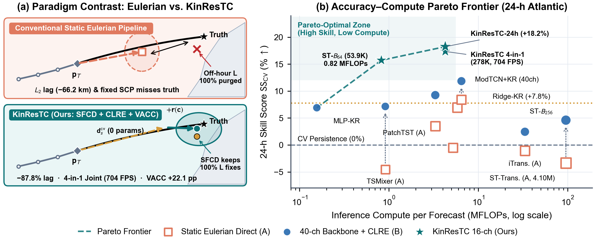
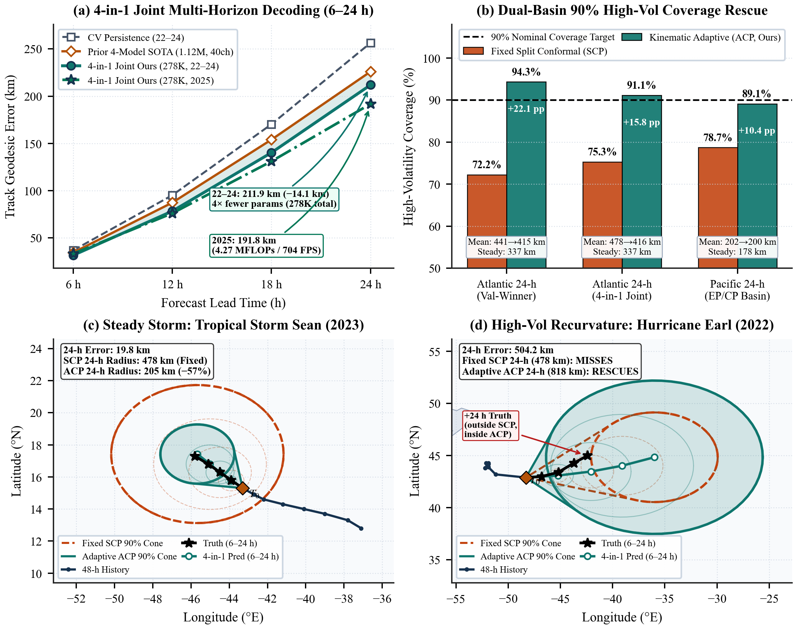

# Beyond Static Coordinates: Physics-Guided Kinematic Residual Learning for Landfall-Complete Tropical Cyclone Track Forecasting

### 超越静态坐标：面向完整近海登陆评估的物理引导运动学残差热带气旋路径预测

[](https://www.python.org/)
[](https://pytorch.org/)
[-0f766e)](https://www.nhc.noaa.gov/data/)
[](LICENSE)
[](https://github.com/WYH302/TyphoFormer-for-Hurricane-Track-Forecasting/releases/tag/kinematic-residuals-2026-09-24)

> **English** | **[简体中文说明](#-项目简介与中文说明)** | **[Research Journey & Pitfalls / 踩坑实录与思考](#-research-journey-real-pitfalls--observations--真实研究历程踩过的坑与独特观察)** | **[Quickstart / 环境与复现](#-environment-setup--quickstart--环境配置与快速复现)**

---

## 👋 Overview / 项目简介

Welcome! This repository shares the complete reproducible code, unit-tested data contracts, and verification artifacts for **KinResTC**, a lightweight physical-alignment framework for short-range (6–24 h) tropical cyclone track forecasting and risk calibration on official NOAA NHC HURDAT2 archives (**North Atlantic `AL`** and **Eastern/Central North Pacific `EP`/`CP`**).

Rather than chasing ever-larger network depth, this study asks a modest but practical question: *what happens when we align the data-indexing layer (`SFCD`), the coordinate representation layer (`CLRE`), and the uncertainty calibration layer (`VACC`) directly with the physical kinematics of a moving vortex?* We hope our findings, failed hypotheses, and reproducible scripts prove useful to fellow researchers working on Earth-system AI and sequence forecasting—and we warmly welcome critiques, bug reports, and alternative viewpoints.

欢迎访问！本项目开源了轻量级物理对齐框架 **KinResTC** 的全部复现代码、自动化数据契约与双海域实测结果，聚焦北大西洋（`AL`）与东/中北太平洋（`EP`/`CP`）官方 NOAA NHC HURDAT2 档案上的短临（6–24 小时）热带气旋路径预测与不确定性校准。我们没有盲目堆叠更深的网络，而是尝试把**数据索引层（`SFCD`）**、**坐标表示层（`CLRE`）**与**风险校准层（`VACC`）**共同对齐到气旋本身的物理运动学规律。希望这份研究过程、踩过的坑与代码工具能对同行有所启发；由于水平有限，项目难免存在疏漏，衷心欢迎各位批评指正与交流讨论。

<p align="center">
  
</p>

<p align="center">
  
</p>

---

## 🧭 Research Journey, Real Pitfalls & Observations / 真实研究历程、踩过的坑与独特观察

In the spirit of transparent and humble open science, we would like to share four genuine pitfalls we ran into during this project—because every single component of **KinResTC** was born from diagnosing an unexpected failure rather than from a top-down design:

本着坦诚、务实的开源精神，这里记录我们在研究过程中**真实踩过的四个坑与观察心得**——事实上，**KinResTC** 的每一个模块都不是凭空拍脑袋设计出来的，而是在一次次“实验打脸”与数据排雷后倒逼出的解法：

1. **Pitfall #1 — Watching a 4.10M-Parameter Transformer Lose to a 0-Parameter Straight Line (`−66.2 km` Eulerian Lag Trap):**  
   Early on, we trained a 3-layer Pre-Norm ST-Transformer directly predicting 24-h displacements in a static coordinate frame, expecting attention to capture steering trajectories. To our surprise, it scored **265.0 km**—*worse* than trivial zero-parameter constant-velocity (`CV`) persistence (**256.4 km**)! Decomposing errors into along-track vs. cross-track directions exposed the culprit: under finite-sample training (~3,762 windows) and standard $L_2$ weight decay, gradient descent shrinks the dominant translational velocity term, dragging forecasts **−66.17 km** behind moving storms. Anchoring the output analytically to $\mathbf{d}_s^{\mathrm{cv}}$ (`CLRE`) removed **87.8%** of that lag at zero parameter cost and lifted **every single one of 10 model families** we subsequently tested (**72/72** Atlantic, **8/8** Pacific, **6/6** 5-fold storm CV).  
   **踩坑一（410 万参数 Transformer 跑输零参数直线外推）：** 最初我们在静态坐标系下直接回归未来位移，满怀期待地跑完 3 层时空 Transformer，结果 24 h 误差竟高达 265.0 km，甚至不如最简单的等速直线外推（256.4 km）。把误差拆解到沿路径与跨路径两个方向后才恍然大悟：有限样本叠加 $L_2$ 权重衰减会系统性压缩一阶平流速度项，导致预测整体“拖尾滞后”达 **−66.17 km**。将物理等速项 $\mathbf{d}_s^{\mathrm{cv}}$ 显式解析锚定后（`CLRE`），滞后偏差直接消减 **87.8%**，且在后续测试的 **10 类架构家族**上全部 100% 稳定提分。

2. **Pitfall #2 — Discovering That Standard Slicing Silently Deleted 100% of Off-Hour Coastal Landfalls:**  
   While inspecting qualitative tracks on 2022–2025 hurricanes, we noticed something unsettling: several catastrophic coastal landfalls—including **Category-5 Hurricane Otis (2023)** and **Hurricane Melissa (2025)**—were mysteriously missing from our test windows! Auditing the HURDAT2 raw text files revealed that NHC inserts minute-precise landfall (`L`) entries *between* canonical 6-hourly rows (e.g., `03:15 UTC`). Standard contiguous-row `Δt = 6 h` slicing flags every off-hour `L` row as a cadence break and silently throws away **100% of off-hour future-landfall windows**. Decoupling the canonical 6-h stream from asynchronous event tables (`SFCD`, verified by `C1–C8` unit contracts) restored **613 coastal landfall windows** across both basins without altering a single genuine observation.  
   **踩坑二（100% 非整点登陆台风被悄悄删光的隐形陷阱）：** 做个案可视化时我们疑惑地发现，2023 五级飓风 Otis 和 2025 飓风 Melissa 等关键近海登陆样本竟在测试集中凭空消失了！逐行排查 HURDAT2 原始文件才发现，NHC 会在 00/06/12/18 UTC 整点记录之间插入精确到分钟的非整点登陆行（标记 `L`），传统的连续行索引切片会把这些记录误判为“时间间隔断层”，导致 **100% 非整点未来登陆窗被静默丢弃**。由此我们提出了 `SFCD` 天气尺度优先解耦协议与 `C1–C8` 自动化契约测试，在绝不篡改原始观测的前提下双海域共找回 **613 个未来登陆窗口**。

3. **Pitfall #3 — Less Is More on Finite Basin Archives (Why Dual-Branch Gating Wasn't Needed & Why Pruning 40 → 16 Channels Won Big):**  
   We initially hypothesized that a learned Adaptive Dual-Branch gate (`Head D`) and all 40 advisory covariates (wind radii, RMW, one-hot storm status) would outperform simpler designs. Controlled 108-run ablations humbled that assumption: (a) once anchored to $\mathbf{d}_s^{\mathrm{cv}}$, a single residual head (`Head B`) already captured the full inertial benefit (*inertial sufficiency*); and (b) because historical wind-radii fields are sparse and noisy, pruning from **40 → 16 pure kinematic channels** and shortening lookback from **66 h (`L=12`) → 42 h (`L=8`)** inside one shared **278K 4-in-1 joint convolutional trunk** (or ultra-compact **53.9K ST-$B_{64}$**) cut Atlantic 24-h error by another **~14–16 km** while reducing FLOPs by **6.1×**.  
   **踩坑三（在有限气象样本上“做减法”反而吊打“堆复杂度”）：** 起初我们猜测“自适应双分支门控（Head D）+ 全量 40 维气象特征”会最强，但 108 组对照实验给了我们当头棒喝：一方面，只要解析锚定到位，单头残差（Head B）已足够充分，双分支门控并无稳定优势；另一方面，由于历史象限风圈和风暴状态位高度稀疏含噪，把输入精简为 **16 维纯运动学通道**、回看窗口缩短到 **42 小时（`L=8`）**并用共享 **278K 4-in-1 联合解码器**替代四个独立编码器后，参数砍掉 4 倍、计算量砍掉 6.1 倍，24 h 误差反而再降 **14–16 km**。

4. **Pitfall #4 — Why "90% Conformal Coverage" Quietly Collapsed Right When Hurricanes Recurved:**  
   When we first added standard Split Conformal Prediction (`SCP`), average test coverage looked reassuring (~90%). Yet stratifying by trajectory volatility exposed a dangerous blind spot: on the top-25% rapidly recurving hurricanes (such as Hurricane Earl), fixed-radius `SCP` coverage plunged to **72.2%**, while issuing bloated warning circles on steady trade-wind storms like Sean. Normalizing residuals by a simple 5-feature real-time kinematic volatility score (`VACC`, just **6 scalars** and **2.34 µs** overhead, zero retraining) lifted high-volatility 90% coverage by **+22.1 pp** (Atlantic) and **+10.4 pp** (Pacific) while *shrinking* steady-storm warning radii by up to **−57%**.  
   **踩坑四（“平均 90% 覆盖率”掩盖了急转气旋的预警失灵）：** 最初引入固定半径共形预测（SCP）时，整体平均覆盖率看似达标；但按运动波动度分层检查后冷汗直冒——在最危险的前 25% 急转弯气旋上，固定半径覆盖率骤降到 **72.2%**，而在平稳移动的热带风暴上预警圈又大得离谱。最终我们引入仅 **6 个标量（2.34 µs 耗时、零重训）**的实时波动归一化共形层（`VACC`），才真正实现“急转时自动扩圈保底（+22.1 pp）、平稳时主动缩圈减误报（最高 −57%）”。

---

## ✨ Key Empirical Results / 核心实测汇总

<p align="center">
  
</p>

<p align="center">
  
</p>

| Model Family / 模型配置 | Params | MFLOPs | CPU FPS (ms) | Atlantic 24 h (22–24 / 25) | Pacific 24 h (22–24 / 25) | 5-Fold Storm CV |
| :--- | :---: | :---: | :---: | :---: | :---: | :---: |
| **Constant-Velocity (`CV`)** | 0 | 0.000 | — | 256.4 / 247.5 | 125.2 / 119.4 | 244.97 ± 18.50 |
| **Ridge Residual (`Ridge-KR`, 16ch)** | 258 | 0.001 | >10k (0.12) | 225.2 / 200.2 | 114.4 / 114.8 | <u>225.54 ± 12.45</u> |
| **LSTM + KR (40ch)** | 227.8K | 5.227 | 1,248 (0.80) | 233.4 / 202.3 | 114.0 / 115.6 | 228.90 ± 8.48 (5/5) |
| **PatchTST + KR (ICLR 2023, 40ch)** | 421.2K | 3.302 | 1,005 (1.00) | 232.7 / 204.7 | 115.9 / 115.8 | 230.56 ± 10.79 (5/5) |
| **TimeMixer + KR (ICLR 2024, 40ch)** | 461.4K | 5.835 | 390 (2.56) | 233.5 / 198.8 | 116.3 / 117.3 | — |
| **ModernTCN + KR (ICLR 2024, 40ch)** | 280.9K | 6.474 | 634 (1.58) | 226.0 / 203.8 | 114.3 / 117.9 | **225.47 ± 7.36** |
| **Ultra-Compact ST-$B_{64}$ (16ch, $L=8$)** | **53.9K** | **0.823** | **1,764 (0.57)** | 216.1 / 193.2 | 116.8 / 114.2 | 230.46 ± 16.12 (5/5) |
| **KinResTC 4-in-1 Joint (16ch, ALL 4 leads)** | **278.2K** | **4.273** | **704 (1.42)** | **211.9 / 191.8** *(6–24h: 31.7/78.4/140.2/211.9)* | — | — |
| **KinResTC-24h (16ch, $L=8$, EMA)** | 277.8K | 4.272 | 733 (1.37) | **210.0 / 190.8** *(Hav/Ridge: **209.6 / 190.6**)* | **113.3 / 111.0** | — |
| **KinResTC SFCD Landfall-Complete (905/187w)** | 277.8K | 4.272 | 733 (1.37) | **204.3 / 199.6** *(Ens: **203.0 / 198.2**)* | *Cat-5 Otis: up to **−117.9 km*** | — |

---

## 📁 Repository Structure / 仓库结构

```text
.
├── assets/                          # README preview PNG figures
├── figures/                         # Publication vector figures (PDF/SVG) & editable PPTX architecture diagram
├── kinematic_residual/              # CLRE models, 10-family SOTA benchmarks, 4-in-1 joint decoding, VACC cones & unit tests
│   ├── controlled_heads.py          #   Controlled ST-Transformer heads (A/B/C/D) & tangent-plane projection
│   ├── sota_sequence_baselines.py   #   7 external sequence families (LSTM/GRU/TSMixer/PatchTST/iTransformer/ModernTCN/TimeMixer)
│   ├── eastern_pacific_cross_basin.py # Independent Eastern/Central North Pacific (EP/CP) verification
│   ├── stage2_sota_cv_profile.py    #   ICLR-2024 baselines + leakage-free 5-fold storm-grouped CV
│   ├── tier1_extreme_roi_surgery.py #   16-channel L=8 CLRE, 4-in-1 joint decoding & 6-scalar VACC conformal cones
│   ├── kinrestc_synoptic_landfall_gpu.py # End-to-end SFCD landfall-complete retraining & paired bootstrap
│   └── tests/                       #   Automated kinematic unit tests
├── synoptic_reconstruction/         # SFCD protocol, C1-C8 data contracts & HURDAT2 coastal landfall audit
│   ├── test_window_contract.py      #   8 formal unit-tested software contracts (C1-C8)
│   └── ...                          #   Reconstruction, coastal stratification & 1980-2003 historical audit scripts
├── requirements.txt                 # Minimal verified Python dependencies (CPU & CUDA)
├── AUTHORS.md                       # Complete author list & upstream attribution
├── CITATION.cff                     # Machine-readable software citation metadata
└── LICENSE                          # MIT License
```

---

## ⚙️ Environment Setup & Quickstart / 环境配置与快速复现

### 1. Environment Installation / 环境配置

Verified on **Python 3.10–3.12** (tested with both CPU-only PyTorch and NVIDIA CUDA 12.8 on a single RTX 3090 with `< 1.2 GB` peak VRAM):

```bash
# Option A: Conda / Virtualenv (Recommended)
conda create -n kinrestc python=3.11 -y
conda activate kinrestc

# Install dependencies (see requirements.txt; install CUDA PyTorch wheel first if using a GPU)
pip install -r requirements.txt
```

### 2. Run Contract & Unit Tests / 运行契约与单元测试

```bash
# Verify all C1-C8 SFCD landfall contracts and kinematic residual unit tests (24 passed)
pytest -q synoptic_reconstruction/test_window_contract.py kinematic_residual/tests/
```

### 3. Reproduce Core Experiments / 复现核心实验

```bash
# 10-family Atlantic SOTA universality & Eastern/Central Pacific cross-basin transfer
python kinematic_residual/sota_sequence_baselines.py
python kinematic_residual/eastern_pacific_cross_basin.py

# Leakage-free 5-fold storm-grouped cross-validation (287 storms) & Cat-5 Otis case audit
python kinematic_residual/stage2_sota_cv_profile.py
python kinematic_residual/stage2_cv_and_cases.py

# 16-channel L=8 CLRE, 4-in-1 Joint Decoding, 2.34 µs VACC Conformal Cones & SFCD Landfall Closure
python kinematic_residual/tier1_extreme_roi_surgery.py
python kinematic_residual/kinrestc_synoptic_landfall_gpu.py
python kinematic_residual/export_fig10_and_profile.py
```

---

## 📌 Scope & Honest Limitations / 适用边界与坦诚局限

We believe stating what a method *cannot* do is just as important as reporting where it works:
- **Advisory-Only Predictability Horizon:** KinResTC operates strictly on best-track advisory kinematics without 3D gridded reanalysis (e.g., 500 hPa geopotential height), making it ideal for sub-millisecond short-range (6–24 h) updates, while medium-range (48–120 h) forecasts governed by approaching midlatitude troughs still benefit from 3D dynamical or weather foundation models.
- **Inland Friction Deceleration:** Right after coastal landfall, surface friction rapidly damps storm speed; unweighted constant-velocity persistence can slightly overshoot decelerating inland segments unless explicit friction damping is introduced.
- **Climate Non-Stationarity:** VACC's finite-sample guarantee assumes approximate storm-level exchangeability across seasons; abrupt poleward track shifts motivate periodic rolling recalibration of its six validation scalars.

---

## 📖 项目简介与中文说明

1. **随动拉格朗日运动学残差引擎（`CLRE`，零额外参数/FLOPs）**：在局部等距切平面上以解析等速惯性外推 $\mathbf{d}_s^{\mathrm{cv}}$ 为锚点，消除 **87.8%** 沿路径滞后偏差，在十类模型家族上全面稳定胜出：北大西洋 **72/72（100%）**、东太平洋 44 风暴主测试集 **8/8（100%）**、无泄漏 5 折风暴分组交叉验证 **6/6（100%）** 并显著收敛跨折方差。
2. **天气尺度优先解耦层（`SFCD`，`C1–C8` 契约）**：消除 HURDAT2 档案因非整点登陆（`L`）记录导致的 100% 非整点登陆漏删盲区，双海域累计恢复 **613 个未来登陆窗口**（含 2023 五级飓风 Otis 与 2025 飓风 Melissa）；端到端重训的 16 通道 **KinResTC** 在大西洋 905 窗完整重构集上达 **204.32 km**（3 种子集成 **202.96 km**）、2025 年降至 **199.59 km**（集成 **198.19 km**），2023 五级飓风 Otis 误差最高降低 **117.9 km**。
3. **16 通道 4-in-1 非迭代联合解码与 2.34 µs 动态共形预警锥（`VACC`）**：不增加任何额外训练数据，通过 **16 通道纯运动学剪枝 + $L=8$ 回看 + EMA + 4-in-1 联合解码**（**278.2K 总参数、4.27 MFLOPs、704 FPS**，参数砍 4 倍、计算量砍 6.1 倍），将北大西洋 24 h 误差压至 **211.9 / 191.8 km**（单时效集成 **209.61 / 190.57 km**），东太平洋 2025 刷新至 **111.01 km**；超轻量 **53.9K `ST-B64`** 达 **1,764 FPS（0.82 MFLOPs）**。零训练成本、仅 **6 个标量（2.34 µs）** 的 `VACC` 共形层将双海域高波动急转气旋的 90% 覆盖率分别从 **72.2%→94.3%（+22.1 pp）** 与 **78.7%→89.1%（+10.4 pp）**，同时稳态热带风暴预警半径大幅收缩（Sean 实测 `-57%`）。

---

## 🤝 Feedback, Critiques & Contributions / 欢迎批评指正与交流

This project is an ongoing research effort, and there is certainly room for improvement—especially in coupling lightweight 3D environmental steering features, modeling inland landfall friction, and extending `SFCD + VACC` to global IBTrACS basins (e.g., Western North Pacific typhoons). **Issues, critical discussions, reproduction checks, and pull requests are warmly welcomed!**

水平有限，代码与分析中难免存在考虑不周或可进一步优化之处（例如融入轻量 3D 环境引导场、显式建模登陆后陆面摩擦减速、拓展至西北太平洋 IBTrACS 台风档案等）。**衷心欢迎各位专家同行与开源社区朋友批评指正、提出宝贵建议或提交 Issue / PR 共同交流进步！**

---

## 📝 Citation / 引用参考

If this code, data-contract protocol, or empirical benchmark helps your research, we would be grateful if you cite:

```bibtex
@article{wu2026kinrestc,
  title   = {Beyond Static Coordinates: Physics-Guided Kinematic Residual Learning for Landfall-Complete Tropical Cyclone Track Forecasting},
  author  = {Wu, Yonghao and Wu, Jiayang and He, Sirui and Liu, Chang and Filaretov, Vladimir and Yukhimets, Dmitry},
  year    = {2026},
  url     = {https://github.com/WYH302/TyphoFormer-for-Hurricane-Track-Forecasting}
}
```
