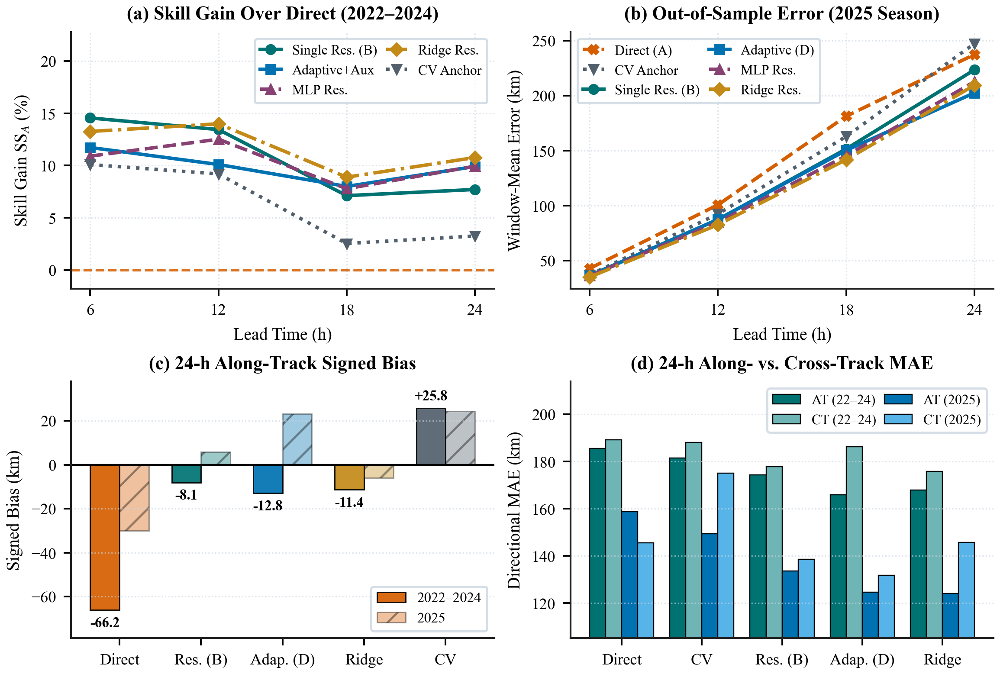
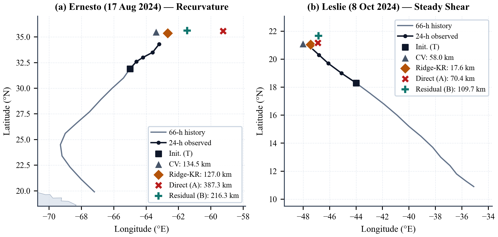

# Kinematic Residual Learning and Evaluation Coverage in Short-Range Atlantic Tropical Cyclone Track Prediction
### 北大西洋短临热带气旋路径预测中的运动学残差学习与评估覆盖度研究

[](https://www.python.org/)
[](https://pytorch.org/)
[](https://www.nhc.noaa.gov/data/)
[](LICENSE)
[](https://github.com/WYH302/TyphoFormer-for-Hurricane-Track-Forecasting/releases/tag/kinematic-residuals-2026-09-24)
[](https://colab.research.google.com/github/WYH302/TyphoFormer-for-Hurricane-Track-Forecasting/blob/main/demo.ipynb)

> **English** | **[简体中文说明](#-项目简介与中文说明)**

An open-source empirical study and reproducibility toolkit exploring **Lagrangian kinematic residual parameterization** and **synoptic-first best-track window reconstruction** for short-range (6–24 h) North Atlantic tropical cyclone track prediction on the public NOAA HURDAT2 archive. We share these implementations, automated verification tests, and baseline comparisons in the hope that they may be helpful to researchers studying physics-guided sequence modeling and coastal hazard verification. Feedback, issues, and suggestions are warmly welcome.

本项目整理并开源了我们在北大西洋短临（6–24 小时）热带气旋路径预测中的方法探索、对比基线与数据重构复现工具。我们将相关代码、自动化检验脚本与实验记录公开，希望能为从事气象序列建模与近海台风/飓风灾害评估的研究者提供一点参考与便利，诚挚欢迎各位同行批评指正与交流。

<p align="center">
  
</p>

---

## 📖 Overview (English)

### 1. Motivation & Methodological Summary

In short-range (6–24 h) tropical cyclone forecasting, vortex translational inertia and steering persistence account for the majority of storm displacement. This repository investigates two practical questions on the NOAA HURDAT2 archive:

1. **Co-Moving Kinematic Residual Parameterization (`kinematic_residual/`):**  
   Direct coordinate regression in a static Eulerian frame ($A$) requires neural sequence encoders to approximate first-order linear translation $\mathcal{O}(\|v_T\|\Delta t)$ simultaneously with second-order curvature and acceleration departures $\mathcal{O}(\|a_T\|\Delta t^2)$, often resulting in systematic along-track lag. Anchoring predictions to local tangent-plane constant-velocity persistence ($B: \widehat{D}_s = D_s^{\mathrm{cv}} + r(c)$) allows the model to focus on non-inertial synoptic departures without adding extra trainable parameters. We compare four controlled output heads—**Direct ($A$)**, **Single Residual ($B$)**, **Fixed Dual ($C$)**, and **Adaptive Gated Dual ($D$)**—alongside linear **Ridge** and compact **MLP** residual baselines.

2. **Synoptic-First Temporal Reconstruction (`synoptic_reconstruction/`):**  
   Best-track archives interleave regular 6-hourly synoptic fixes (`00, 06, 12, 18 UTC`) with unscheduled landfall (`L`) entries recorded at exact landfall minutes. Conventional contiguous-row sequence slicing treats intermediate `L` entries as cadence irregularities and inadvertently discards future-landfall windows. Our timestamp-indexed **Synoptic-First Reconstruction** protocol decouples regular 6-hourly history from asynchronous `L` hazard tags (verified by 8 unit-tested invariants `C1`–`C8`), expanding the 2022–2024 24-h test cohort from **630 to 905 windows** (`30 -> 40` storms) and restoring **101 future-landfall windows** across 20 storms.

<p align="center">
  
</p>

---

## 📖 项目简介与中文说明

### 1. 研究背景与核心思路

在 6–24 小时短临热带气旋路径预测中，涡旋平动惯性与大尺度引导气流持续性主导了气旋的主要位移。围绕公开的美国国家飓风中心（NOAA NHC）**HURDAT2** 最佳路径数据集，本仓库主要包含以下两部分开源内容：

1. **随动拉格朗日运动学残差参数化（`kinematic_residual/`）：**  
   常规序列模型通常在静止欧拉坐标系下直接回归未来总位移（Head $A$），模型需要同时拟合一阶平动惯性与二阶转向/加减速分量，容易产生沿路径方向的系统性滞后偏差（Along-Track Lag）。我们将输出端锚定于局部切平面上的等速惯性外推基准（$B: \widehat{D}_s = D_s^{\mathrm{cv}} + r(c)$），在不增加任何额外可训练参数的前提下，让编码器专注于学习非惯性天气尺度偏离量。仓库提供了受控的四层输出头对比（**Direct $A$**、**Single Residual $B$**、**Fixed Dual $C$**、**Adaptive Dual $D$**）以及线性 **Ridge** 与轻量级 **MLP** 残差基线。
2. **面向近海登陆评估的天气尺度优先重构协议（`synoptic_reconstruction/`）：**  
   HURDAT2 等最佳路径档案在常规 6 小时天气尺度观测（`00, 06, 12, 18 UTC`）之间穿插了精确到分钟的非整点近海登陆记录（标识符 `L`）。传统的“按连续行切片并检查 6 小时间隔”预处理逻辑会将穿插的 `L` 记录误判为时间步异常，导致测试集中包含未来登陆事件的样本被全部剔除。我们提供了基于时间戳索引的**天气尺度优先（Synoptic-First）重构脚本**及 8 项自动化契约测试（`C1`–`C8`），在严格保持 6 小时物理步长的同时完整保留 `L` 登陆标签，使 2022–2024 年 24 小时测试窗口从 **630 个恢复至 905 个**（覆盖气旋从 30 个增至 40 个），恢复了 **20 个气旋的 101 个未来登陆窗口**。

<p align="center">
  
</p>

---

## 📊 Summary of Empirical Results / 主要实验结果汇总

### 1. Multi-Horizon Geodesic Track Errors / 多时效路径误差对比 (km)

| Cohort / 数据集划分 | Method / 模型方法 | RMW | 6 h | 12 h | 18 h | 24 h |
| :--- | :--- | :---: | :---: | :---: | :---: | :---: |
| **2022–2024 Test** | Constant-Velocity (`CV`) | — | 36.87 | 95.22 | 170.27 | 256.39 |
| **2022–2024 Test** | Ridge Kinematic Residual | off | 35.49 | 89.85 | **158.50** | **235.26** |
| **2022–2024 Test** | MLP Kinematic Residual | off | 36.26 ± 0.22 | 90.71 ± 0.26 | 158.96 ± 2.45 | 237.25 ± 2.47 |
| **2022–2024 Test** | A: Direct Eulerian Transformer | on | 41.01 ± 0.38 | 104.86 ± 5.33 | 174.69 ± 3.44 | 265.00 ± 4.16 |
| **2022–2024 Test** | **B: Single Residual Transformer** | on / off | **35.04 ± 0.64** (on) | **89.78 ± 0.27** (off) | 162.26 ± 2.97 | 244.58 ± 7.96 |
| **2025 Season** | Constant-Velocity (`CV`) | — | 36.91 | 92.28 | 162.86 | 247.45 |
| **2025 Season** | Ridge Kinematic Residual | on | **34.87** | **82.46** | **141.74** | 209.53 |
| **2025 Season** | A: Direct Eulerian Transformer | on | 42.68 ± 1.34 | 100.60 ± 0.93 | 181.35 ± 8.49 | 237.53 ± 2.52 |
| **2025 Season** | **B: Single Residual Transformer** | off | 35.44 ± 1.36 | 86.21 ± 4.07 | 151.32 ± 4.21 | 216.43 ± 9.74 |
| **2025 Season** | **D: Adaptive Dual Transformer** | on | 35.84 ± 1.38 | 87.35 ± 8.43 | 150.29 ± 8.22 | **202.59 ± 3.30** |

### 2. Coastal Landfall Cohorts & Case Studies / 近海登陆子集表现与典型个例

- **24-h Along-Track Lag Reduction (沿路径滞后偏差改善):** Equal-storm signed along-track bias on 2022–2024 drops by **87.8%** from `−66.17 km` (Direct $A$) to `−8.06 km` (Single Residual $B$).
- **Restored Future-Landfall Windows (`L` in $(T, T+24\text{ h}]$):** On the 101 restored future-landfall windows (2022–2024), Single Residual ($B$) lowers equal-storm geodesic error by **51.89 km** (`284.88 -> 232.99 km`, 95% storm-bootstrap CI `[−89.96, −13.35] km`) relative to Direct Eulerian regression ($A$), and by **102.22 km** (`295.3 -> 193.1 km`) on the 10 restored landfall windows in 2025.

<p align="center">
  
</p>

---

## ⚙️ Compute Footprint & Hardware Environment / 计算资源与运行开销

All experiments are lightweight and reproducible on a single consumer workstation without requiring multi-GPU clusters:
所有实验均可在单张消费级显卡或普通 CPU 上快速复现：

- **Hardware / 硬件平台:** 1 × NVIDIA GeForce RTX 3090 GPU (24 GB VRAM), Python 3.11, PyTorch 2.8.
- **Total GPU Training Time / 训练总耗时:**
  - 108 primary controlled Transformer runs (4 horizons × 9 configs × 3 seeds, 40 epochs): **5.04 GPU hours** (~2.8 min per run).
  - Full 123-run neural suite (including encoder capacity & synoptic-first retraining): **5.44 GPU hours** total.
  - 24 MLP residual fits: **9.87 CPU minutes**; 8 SVD Ridge grid fits: **1.08 CPU seconds**.
- **Inference Latency / 推理延迟:** **3.58 ms** per window on 1 CPU thread (`batch_size = 1`), and **1.87 ms** per batch of 32 on RTX 3090.

---

## 🗂️ Repository Structure / 仓库目录结构

```text
├── kinematic_residual/              # Co-moving kinematic residual heads (A-D), Ridge/MLP/Transformer runners
│   ├── prepare_frozen.py            # Tangent-plane projection M(p; p0), Haversine metric & HURDAT2 builder
│   ├── controlled_heads.py          # Direct (A), Single Residual (B), Fixed Dual (C), Adaptive Dual (D)
│   ├── run_controlled.py            # Single-run Transformer training & validation checkpoint selection
│   ├── run_matrix.py                # Multi-horizon (6, 12, 18, 24 h) & multi-seed (42, 123, 2024) matrix
│   ├── ridge_baseline.py            # Exact SVD Ridge kinematic residual baseline
│   ├── mlp_residual_baseline.py     # Two-layer GELU MLP kinematic residual baseline
│   ├── analyze_revision.py          # 10,000-resample whole-storm cluster bootstrap & directional metrics
│   ├── benchmark_inference.py       # Single-thread CPU & GPU forward-pass latency benchmarks
│   ├── vendor/                      # Pre-LayerNorm Sequence Transformer encoder backbone
│   └── tests/                       # Unit tests for output heads and baselines
├── synoptic_reconstruction/         # Synoptic-first HURDAT2 temporal reconstruction & coastal verification
│   ├── prepare_revision.py          # 4-stage Synoptic-First reconstruction pipeline
│   ├── test_window_contract.py      # Automated pytest suite for invariants C1-C8
│   ├── run_training.py              # End-to-end 24-h synoptic-first retraining script
│   ├── summarize_revision.py        # Coastal proximity & landfall stratum evaluation
│   └── summaries/                   # Saved verification JSON summaries & feature schemas
├── figures/                         # Vector PDF figures
├── assets/                          # High-resolution PNG/SVG visual illustrations
├── TyphoFormerPlus/                 # Earlier prototype scripts and ablation utilities
├── TyphoFormer_original/            # Reference snapshot of upstream LabRAI/TyphoFormer baseline
├── demo.py / demo.ipynb             # Self-contained offline HTML interactive results viewer
├── CITATION.cff                     # Citation metadata
├── AUTHORS.md                       # Author list and institutional affiliations
└── LICENSE                          # MIT License
```

---

## 🚀 Quickstart / 快速上手

```bash
# 1. Install dependencies / 安装依赖
pip install -r requirements.txt

# 2. Run automated data-integrity & unit tests / 运行 C1-C8 数据一致性测试与单元测试
pytest synoptic_reconstruction/test_window_contract.py
pytest kinematic_residual/tests/

# 3. Reconstruct synoptic-first HURDAT2 windows / 重构天气尺度优先序列窗口与登陆标注
python synoptic_reconstruction/prepare_revision.py

# 4. Train & evaluate controlled parameterizations / 运行受控多时效训练与评估
python kinematic_residual/run_matrix.py --data-root data --output results/controlled_matrix --device cuda --evaluate-2025

# 5. Launch offline HTML results explorer / 生成本地交互式结果浏览页
python demo.py
```

---

## 📦 Release Archives / 论文与复现附件下载

Pre-built reproducibility bundles and supplementary appendices are available under **[GitHub Releases](https://github.com/WYH302/TyphoFormer-for-Hurricane-Track-Forecasting/releases/tag/kinematic-residuals-2026-09-24)**:
- **`manuscript.pdf`** — Full manuscript (6-section structure, 58 references).
- **`ESM_2.pdf`** — Complete supplementary statistical appendices (Appendices A–E).
- **`editable_manuscript.zip`** — Self-contained LaTeX source package and vector figures.
- **`ESM_1.zip`** — Saved model predictions and score-verification archive.

---

## 📝 Citation / 引用参考

If this repository or data reconstruction protocol is helpful for your work, you may cite:

```bibtex
@article{wu2026kinematic,
  title   = {Kinematic Residual Learning and Evaluation Coverage in Short-Range Atlantic Tropical Cyclone Track Prediction},
  author  = {Wu, Yonghao and Wu, Jiayang and He, Sirui and Liu, Chang and Filaretov, Vladimir and Yukhimets, Dmitry},
  year    = {2026},
  url     = {https://github.com/WYH302/TyphoFormer-for-Hurricane-Track-Forecasting}
}
```
