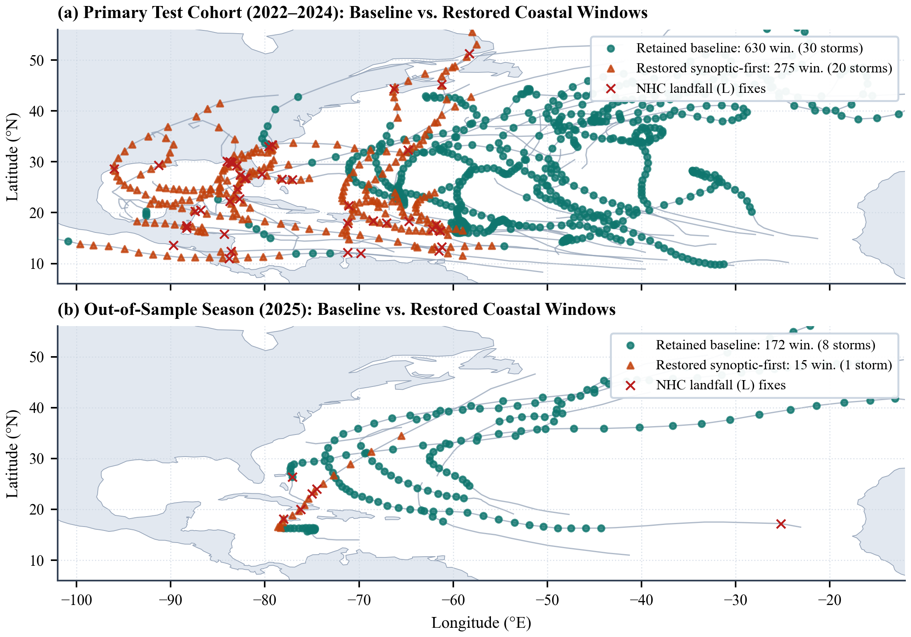

# Kinematic Residual Learning and Evaluation Coverage in Short-Range Atlantic Tropical Cyclone Track Prediction
### 北大西洋短临热带气旋路径预测中的运动学残差学习与评估覆盖度研究

[](https://www.python.org/)
[](https://pytorch.org/)
[](https://www.nhc.noaa.gov/data/)
[](LICENSE)
[](https://github.com/WYH302/TyphoFormer-for-Hurricane-Track-Forecasting/releases/tag/kinematic-residuals-2026-09-24)
[](https://colab.research.google.com/github/WYH302/TyphoFormer-for-Hurricane-Track-Forecasting/blob/main/demo.ipynb)

> **English** | **[简体中文说明](#-项目简介与中文说明)**

An open-source empirical study and reproducibility toolkit exploring **Lagrangian kinematic residual parameterization** and **synoptic-first best-track window reconstruction** for short-range (6–24 h) North Atlantic tropical cyclone track prediction on the public NOAA HURDAT2 archive. We share these implementations, multi-architecture baseline comparisons, and automated data-verification scripts in the hope that they may be helpful to researchers studying physics-guided sequence modeling and coastal hazard verification. Feedback, issues, and suggestions are warmly welcome.

本项目整理并开源了我们在北大西洋短临（6–24 小时）热带气旋路径预测中的方法探索、主流序列基线对比与数据重构复现工具。我们将相关模型代码、自动化契约测试与实验记录公开，希望能为从事气象序列建模与近海台风/飓风灾害评估的研究者提供一点参考与便利，诚挚欢迎各位同行批评指正与交流。

<p align="center">
  
</p>

---

## 📖 Overview (English)

1. **Co-Moving Kinematic Residual Parameterization (`kinematic_residual/`):**  
   Direct coordinate regression in a static Eulerian frame ($A$) forces sequence encoders to approximate first-order vortex translation $\mathcal{O}(\|v_T\|\Delta t)$ simultaneously with second-order curvature and acceleration departures $\mathcal{O}(\|a_T\|\Delta t^2)$, resulting in systematic along-track lag (`−66.17 km` equal-storm bias at 24 h). Anchoring predictions to local tangent-plane constant-velocity persistence ($B: \widehat{D}_s = D_s^{\mathrm{cv}} + r(c)$) eliminates **87.8%** of along-track lag (`−8.06 km`) with zero extra trainable parameters. Across **eight distinct model families**—Ridge, MLP, LSTM, GRU, TSMixer, PatchTST, iTransformer, and our ST-Transformer—switching from Eulerian Direct ($A$) to Lagrangian Residual ($B$) improves window-mean accuracy in **100% of multi-horizon comparisons**.

2. **Synoptic-First Temporal Reconstruction (`synoptic_reconstruction/`):**  
   Best-track archives interleave regular 6-hourly synoptic fixes (`00, 06, 12, 18 UTC`) with unscheduled landfall (`L`) entries recorded at exact landfall minutes. Conventional contiguous-row sequence slicing treats intermediate `L` entries as cadence irregularities and inadvertently discards 100% of future-landfall windows. Our timestamp-indexed **Synoptic-First Reconstruction** protocol decouples regular 6-hourly history from asynchronous `L` hazard tags (verified by 8 unit-tested invariants `C1`–`C8`), expanding the 2022–2024 24-h test cohort from **630 to 905 windows** (`30 -> 40` storms) and restoring **101 future-landfall windows** across 20 storms.

<p align="center">
  
</p>

---

## 📖 项目简介与中文说明

1. **随动拉格朗日运动学残差参数化（`kinematic_residual/`）：**  
   常规序列模型在静止欧拉坐标系下直接回归未来总位移（Head $A$），需同时拟合一阶平动惯性与二阶转向加速度，容易产生沿路径方向的系统性滞后偏差（24 h 等风暴滞后达 `−66.17 km`）。我们将输出端锚定于局部切平面上的等速惯性外推基准（$B: \widehat{D}_s = D_s^{\mathrm{cv}} + r(c)$），在零额外参数开销下消除 **87.8%** 的沿路径滞后偏差（降至 `−8.06 km`）。在受控的 **8 类模型家族**（Ridge、MLP、LSTM、GRU、TSMixer、PatchTST、iTransformer 与 ST-Transformer）共 56 组跨时效对比中，运动学残差参数化在 **100%** 的对比组合中均取得稳定误差下降。
2. **面向近海登陆评估的天气尺度优先重构协议（`synoptic_reconstruction/`）：**  
   HURDAT2 档案在常规 6 小时观测（`00, 06, 12, 18 UTC`）之间穿插了精确到分钟的非整点近海登陆记录（标识符 `L`）。传统按连续行切片的逻辑会将穿插的 `L` 记录误判为时间步异常，导致测试集中未来登陆样本被全部剔除。本仓库提供了基于时间戳索引的**天气尺度优先（Synoptic-First）重构脚本**及 8 项自动化契约测试（`C1`–`C8`），使 2022–2024 年 24 小时测试窗口从 **630 个恢复至 905 个**（覆盖气旋从 30 个增至 40 个），完整恢复 **20 个气旋的 101 个未来登陆窗口**；在该登陆子集上，单残差头相比直接欧拉回归将等风暴误差降低 **51.89 km**。

<p align="center">
  
</p>

---

## 📊 Cross-Architecture SOTA & Multi-Horizon Summary / 跨架构基线与多时效结果汇总

### 1. Universal Improvement Across Sequence Backbones / 主流序列架构对比 (`2022–2024 / 2025` Window-Mean km, RMW On)

| Backbone Architecture / 骨干网络 | Frame / 坐标系 | Params | 6 h (22–24 / 25) | 12 h (22–24 / 25) | 18 h (22–24 / 25) | 24 h (22–24 / 25) |
| :--- | :---: | :---: | :---: | :---: | :---: | :---: |
| **Constant-Velocity (`CV`)** | Inertial Ref. | 0 | 36.87 / 36.91 | 95.22 / 92.28 | 170.27 / 162.86 | 256.39 / 247.45 |
| **Ridge Residual** | + Residual | 962 | 35.57 / **34.87** | 90.18 / **82.46** | 159.17 / 141.74 | 236.47 / 209.53 |
| **MLP Residual** | + Residual | 78.3K | 36.54 / 36.04 | 91.73 / 84.66 | 161.10 / 145.29 | 238.67 / 212.80 |
| **LSTM** (Gao et al., 2018) | Direct ($A$) | 227.8K | 39.63 / 39.97 | 99.78 / 92.57 | 174.01 / 151.08 | 257.74 / 218.91 |
| **LSTM + Kinematic Residual** | **+ Residual ($B$)** | 227.8K | **36.17 / 35.56** | **90.28 / 81.40** | **158.98 / 140.24** | **233.43 / 202.27** |
| **GRU** (Alemany et al., 2019) | Direct ($A$) | 173.0K | 37.93 / 40.51 | 94.50 / 92.26 | 163.70 / 154.64 | 244.16 / 221.81 |
| **GRU + Kinematic Residual** | **+ Residual ($B$)** | 173.0K | **36.10 / 35.84** | **89.61 / 83.33** | **156.99 / 138.55** | **233.94 / 201.90** |
| **TSMixer** (KDD 2023) | Direct ($A$) | 102.4K | 45.11 / 47.34 | 107.62 / 101.49 | 184.25 / 160.34 | 268.02 / 232.93 |
| **TSMixer + Kinematic Residual** | **+ Residual ($B$)** | 102.4K | **37.37 / 36.67** | **93.42 / 85.02** | **163.05 / 144.40** | **238.06 / 208.14** |
| **PatchTST** (ICLR 2023) | Direct ($A$) | 421.2K | 39.74 / 42.90 | 96.34 / 98.02 | 169.41 / 164.68 | 247.46 / 232.88 |
| **PatchTST + Kinematic Residual** | **+ Residual ($B$)** | 421.2K | **35.51 / 35.95** | **89.30 / 85.50** | **158.65 / 143.77** | **232.66 / 204.66** |
| **iTransformer** (ICLR 2024) | Direct ($A$) | 428.5K | 39.31 / 43.17 | 100.04 / 100.36 | 178.61 / 189.37 | 259.13 / 277.23 |
| **iTransformer + Kinematic Residual** | **+ Residual ($B$)** | 428.5K | **36.74 / 36.92** | **93.56 / 92.86** | **167.31 / 159.83** | **250.12 / 238.90** |
| **ST-Transformer (Ours)** | Direct ($A$) | 4.10M | 41.01 / 42.68 | 104.86 / 100.60 | 174.69 / 181.35 | 265.00 / 237.53 |
| **ST-Transformer + Residual** | **+ Residual ($B$)** | 4.10M | **35.04 / 36.22** | **90.76 / 87.10** | **162.26 / 151.51** | **244.58 / 223.56** |
| **ST-Transformer Adaptive Dual** | **+ Adaptive ($D$)** | 4.30M | 35.79 / 35.84 | 93.70 / 87.35 | 164.73 / 150.29 | 247.42 / **202.59** |

<p align="center">
  
</p>

<p align="center">
  
</p>

---

## ⚙️ Compute Footprint & Hardware Environment / 计算资源与运行开销

- **Hardware / 硬件平台:** 1 × NVIDIA GeForce RTX 3090 GPU (24 GB VRAM, 16-core CPU), Python 3.11, PyTorch 2.x.
- **Measured Training Time / 实测训练耗时:**
  - 108 primary controlled ST-Transformer runs (4 horizons × 9 configs × 3 seeds, 40 epochs): **5.04 GPU hours** (~2.80 min per run).
  - Full 123-run GPU suite (including encoder capacity & synoptic-first retraining): **5.44 GPU hours** total.
  - 120 matched multi-architecture SOTA sequence runs (`sota_sequence_baselines.py`): **47.5 minutes** across 12 CPU workers.
- **Inference Latency / 推理延迟:** **3.58 ms** per window on 1 CPU thread (`batch_size = 1`), and **1.87 ms** per batch of 32 on RTX 3090.

---

## 🚀 Quickstart / 快速上手

```bash
# 1. Install dependencies / 安装依赖
pip install -r requirements.txt

# 2. Run automated data-integrity & unit tests / 运行 C1-C8 数据一致性与单元测试
pytest synoptic_reconstruction/test_window_contract.py
pytest kinematic_residual/tests/

# 3. Reconstruct synoptic-first HURDAT2 windows / 重构天气尺度优先序列窗口与登陆标注
python synoptic_reconstruction/prepare_revision.py

# 4. Run controlled ST-Transformer & multi-architecture SOTA baselines / 运行主实验与跨架构基线对比
python kinematic_residual/run_matrix.py --data-root data --output results/controlled_matrix --device cuda --evaluate-2025
python kinematic_residual/sota_sequence_baselines.py

# 5. Launch offline HTML results explorer / 生成本地交互式结果浏览页
python demo.py
```

---

## 📦 Release Archives / 论文与复现附件下载

Pre-built reproducibility bundles and supplementary appendices are available under **[GitHub Releases](https://github.com/WYH302/TyphoFormer-for-Hurricane-Track-Forecasting/releases/tag/kinematic-residuals-2026-09-24)**:
- **`manuscript.pdf`** — Full manuscript (6 canonical sections, 58 verified references).
- **`ESM_2.pdf`** — Complete supplementary statistical appendices (Appendices A–E).
- **`editable_manuscript.zip`** — Self-contained LaTeX source package and vector figures.
- **`ESM_1.zip`** — Saved model predictions and score-verification archive.

---

## 📝 Citation / 引用参考

```bibtex
@article{wu2026kinematic,
  title   = {Kinematic Residual Learning and Evaluation Coverage in Short-Range Atlantic Tropical Cyclone Track Prediction},
  author  = {Wu, Yonghao and Wu, Jiayang and He, Sirui and Liu, Chang and Filaretov, Vladimir and Yukhimets, Dmitry},
  year    = {2026},
  url     = {https://github.com/WYH302/TyphoFormer-for-Hurricane-Track-Forecasting}
}
```
