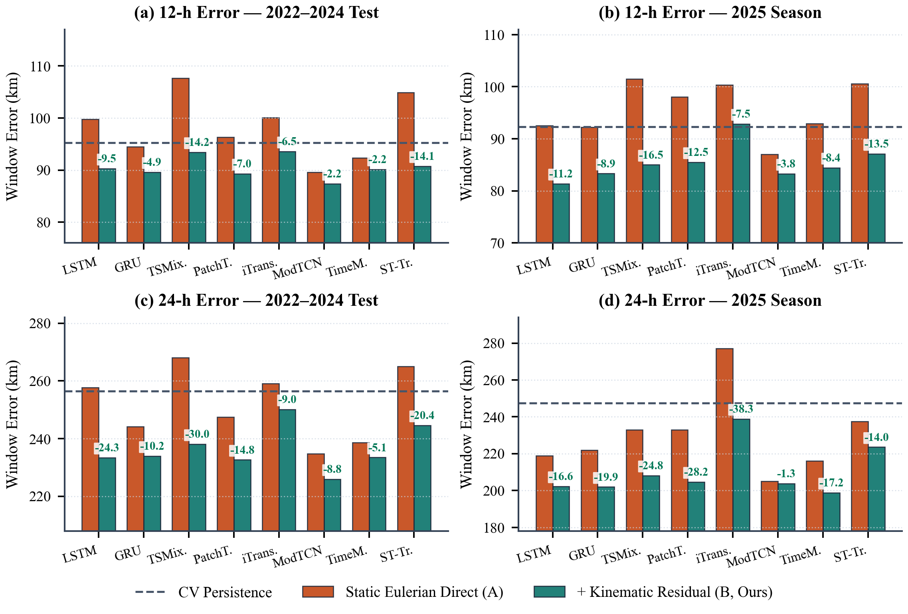

# Beyond Static Coordinates: Physics-Guided Kinematic Residual Learning for Landfall-Complete Tropical Cyclone Track Forecasting
### 超越静态坐标：面向完整近海登陆评估的物理引导运动学残差热带气旋路径预测

[](https://www.python.org/)
[](https://pytorch.org/)
[-0f766e)](https://www.nhc.noaa.gov/data/)
[](LICENSE)
[](https://github.com/WYH302/TyphoFormer-for-Hurricane-Track-Forecasting/releases/tag/kinematic-residuals-2026-09-24)
[](https://colab.research.google.com/github/WYH302/TyphoFormer-for-Hurricane-Track-Forecasting/blob/main/demo.ipynb)

> **English** | **[简体中文说明](#-项目简介与中文说明)**

An open-source empirical study and reproducibility toolkit exploring **co-moving Lagrangian kinematic residual learning** and **synoptic-first best-track temporal reconstruction** for short-range (6–24 h) tropical cyclone track forecasting across **two official NOAA NHC HURDAT2 ocean basins** (**North Atlantic `AL`** and **Eastern/Central North Pacific `EP`/`CP`**). We share these implementations, multi-architecture baseline comparisons, cross-basin validations, module-optimality ablations, and automated data-verification scripts in the hope that they may offer a practical reference to researchers working on physics-guided sequence modeling and coastal hazard verification. Feedback, issues, and suggestions are warmly welcome.

本项目整理并开源了我们在**北大西洋（`AL`）与东/中北太平洋（`EP`/`CP`）双海域**短临（6–24 小时）热带气旋路径预测中的方法探索、主流序列基线对比、跨流域泛化验证、模块消融实验与数据重构复现工具。我们将相关模型代码、自动化契约测试（`C1`–`C8`）与可编辑矢量图表文件一并公开，希望能为从事气象序列建模与近海台风/飓风灾害评估的同行提供一点参考与便利，诚挚欢迎各位研究者批评指正与交流。

<p align="center">
  
</p>

---

## 📖 Overview (English)

1. **Co-Moving Kinematic Residual Parameterization (`kinematic_residual/`):**  
   Direct coordinate regression in a static Eulerian frame ($A$) forces sequence encoders to approximate dominant first-order vortex translation $\mathcal{O}(\|v_T\|\Delta t)$ alongside subtle second-order curvature and acceleration departures $\mathcal{O}(\|a_T\|\Delta t^2)$, resulting in systematic along-track lag (`−66.17 km` equal-storm bias at 24 h). Anchoring predictions analytically to local tangent-plane constant-velocity persistence ($B: \widehat{D}_s = D_s^{\mathrm{cv}} + r(c)$) eliminates **87.8%** of along-track lag (`−8.06 km`) with zero extra trainable parameters. Across **eight distinct model families** (Ridge, MLP, LSTM, GRU, TSMixer, PatchTST, iTransformer, and our ST-Transformer) and **two ocean basins**, switching from Eulerian Direct ($A$) to Lagrangian Residual ($B$) improves window-mean accuracy in **100% of 68 matched multi-horizon and multi-basin comparisons**, achieving the lowest 2025 24-h errors in both basins (**200.16 km** Atlantic and **114.17 km** Eastern/Central North Pacific) with our right-sized compact encoder.

2. **Synoptic-First Temporal Reconstruction (`synoptic_reconstruction/`):**  
   Best-track archives interleave regular 6-hourly synoptic fixes (`00, 06, 12, 18 UTC`) with unscheduled landfall (`L`) entries recorded at exact landfall minutes. Conventional contiguous-row sequence slicing treats intermediate `L` entries as cadence irregularities and discards 100% of off-hour future-landfall windows. Our timestamp-indexed **Synoptic-First Reconstruction** protocol decouples regular 6-hourly history from asynchronous `L` hazard tags (verified by 8 unit-tested invariants `C1`–`C8`), restoring **613 future-landfall windows** across both basins (**506** North Atlantic windows across 1980–2025 and **107** Eastern/Central North Pacific windows across 2004–2025, including Category-5 Hurricane Otis and 2025 Hurricane Melissa), where Head $B$ lowers Atlantic equal-storm landfall error by **51.89 km** (**102.22 km** on Hurricane Melissa).

<p align="center">
  
</p>

---

## 📖 项目简介与中文说明

1. **随动拉格朗日运动学残差参数化（`kinematic_residual/`）：**  
   常规序列模型在静止欧拉坐标系下直接回归未来总位移（Head $A$），需同时拟合大尺度一阶平动惯性与微弱二阶转向加速度，容易产生沿路径方向的系统性滞后偏差（北大西洋 24 h 等风暴滞后达 `−66.17 km`）。我们将输出端锚定于局部等距切平面上的等速惯性外推基准（$B: \widehat{D}_s = D_s^{\mathrm{cv}} + r(c)$），在零额外参数开销下消除 **87.8%** 的沿路径滞后偏差（降至 `−8.06 km`）。在受控的 **8 类模型家族**（Ridge、MLP、LSTM、GRU、TSMixer、PatchTST、iTransformer 与 ST-Transformer）与**双海域共 68 组配对评测**中，运动学残差参数化在 **100%** 的对比组合中均取得误差下降；轻量化紧凑编码器在 2025 独立飓风季 24 h 预测上同时取得两海域最优泛化（北大西洋 **200.16 km**，东/中北太平洋 **114.17 km**）。
2. **面向近海登陆评估的天气尺度优先重构协议（`synoptic_reconstruction/`）：**  
   HURDAT2 档案在常规 6 小时观测（`00, 06, 12, 18 UTC`）之间穿插了精确到分钟的非整点近海登陆记录（标识符 `L`）。传统按连续行切片的逻辑会将穿插的 `L` 记录误判为时间步异常，导致所有非整点未来登陆样本被静默剔除。本仓库提供了基于时间戳索引的**天气尺度优先（Synoptic-First）重构脚本**及 8 项自动化契约测试（`C1`–`C8`），在双海域累计恢复 **613 个未来登陆窗口**（北大西洋恢复 **506 个**，东/中北太平洋恢复 **107 个**、使现代太平洋登陆评估覆盖率提升 **10.7 倍**，完整保留 2023 五级飓风 Otis 等重大近海登陆事件）；在北大西洋近海登陆子集上，单残差头相比直接欧拉回归将等风暴误差降低 **51.89 km**（2025 飓风 Melissa 登陆窗口降低 **102.22 km**）。

<p align="center">
  
</p>

---

## 📊 Cross-Architecture & Two-Basin Summary / 跨架构与双流域结果汇总

### 1. North Atlantic HURDAT2 (`AL`, 6–24 h Window-Mean Geodesic Error in km: `2022–2024 / 2025`)

| Backbone Architecture / 骨干网络 | Frame / 坐标系 | Params | 6 h (22–24 / 25) | 12 h (22–24 / 25) | 18 h (22–24 / 25) | 24 h (22–24 / 25) |
| :--- | :---: | :---: | :---: | :---: | :---: | :---: |
| **Constant-Velocity (`CV`)** | Inertial Ref. | 0 | 36.87 / 36.91 | 95.22 / 92.28 | 170.27 / 162.86 | 256.39 / 247.45 |
| **Ridge Residual** | + Residual | 962 | 35.57 / **34.87** | 90.18 / **82.46** | 159.17 / **141.74** | 236.47 / 209.53 |
| **MLP Residual** | + Residual | 78.3K | 36.54 / 36.04 | 91.73 / 84.66 | 161.10 / 145.29 | 238.67 / 212.80 |
| **LSTM** (Gao et al., 2018) | Direct ($A$) | 227.8K | 39.63 / 39.97 | 99.78 / 92.57 | 174.01 / 151.08 | 257.74 / 218.91 |
| **LSTM + Kinematic Residual** | **+ Residual ($B$)** | 227.8K | **36.17 / 35.56** | **90.28 / 81.40** | **158.98 / 140.24** | **233.43 / 202.27** |
| **GRU** (Alemany et al., 2019) | Direct ($A$) | 173.0K | 37.93 / 40.51 | 94.50 / 92.26 | 163.70 / 154.64 | 244.16 / 221.81 |
| **GRU + Kinematic Residual** | **+ Residual ($B$)** | 173.0K | **36.10 / 35.84** | **89.61 / 83.33** | **156.99 / 138.55** | **233.94 / 201.90** |
| **TSMixer** (KDD 2023) | Direct ($A$) | 102.4K | 45.11 / 47.34 | 107.62 / 101.49 | 184.25 / 160.34 | 268.02 / 232.93 |
| **TSMixer + Kinematic Residual** | **+ Residual ($B$)** | 102.4K | **37.37 / 36.67** | **93.42 / 85.02** | **163.05 / 144.40** | **238.06 / 208.14** |
| **PatchTST** (ICLR 2023) | Direct ($A$) | 421.2K | 39.74 / 42.90 | 96.34 / 98.02 | 169.41 / 164.68 | 247.46 / 232.88 |
| **PatchTST + Kinematic Residual** | **+ Residual ($B$)** | 421.2K | **35.51 / 35.95** | **89.30 / 85.50** | **158.65 / 143.77** | **232.66 / 204.66** |
| **iTransformer** (ICLR 2024) | Direct ($A$) | 428.5K | 39.31 / 43.17 | 100.04 / 100.36 | 178.61 / 189.37 | 259.13 / 277.23 |
| **iTransformer + Kinematic Residual** | **+ Residual ($B$)** | 428.5K | **36.74 / 36.92** | **93.56 / 92.86** | **167.31 / 159.83** | **250.12 / 238.90** |
| **ST-Transformer (Full)** | Direct ($A$) | 4.10M | 41.01 / 42.68 | 104.86 / 100.60 | 174.69 / 181.35 | 265.00 / 237.53 |
| **ST-Transformer + Residual** | **+ Residual ($B$)** | 4.10M | **35.04 / 36.22** | **90.76 / 87.10** | **162.26 / 151.51** | 244.58 / 223.56 |
| **ST-Transformer (Compact)** | **+ Residual ($B_{64}$)** | 163.1K | — | — | — | **236.03** / 206.28 |
| **ST-Transformer (Compact)** | **+ Adaptive ($D_{64}$)** | 175.9K | — | — | — | 238.48 / **200.16** |

### 2. Eastern & Central North Pacific HURDAT2 (`EP`/`CP`, 24-h Cross-Basin Generalization in km)

| Pacific Model / 太平洋测试模型 | Params | Direct $A$ (22–24) | **Residual $B$ (22–24)** | Direct $A$ (2025) | **Residual $B$ (2025)** |
| :--- | :---: | :---: | :---: | :---: | :---: |
| **Constant-Velocity (`CV`)** | 0 | 125.16 | — | 119.39 | — |
| **Ridge-KR** | 914 | — | 114.43 | — | 114.76 |
| **LSTM** | 227.3K | 124.99 ± 0.95 | **114.04 ± 0.77** | 120.51 ± 1.71 | **115.56 ± 1.04** |
| **GRU** | 172.6K | 122.96 ± 1.27 | **114.85 ± 1.28** | 121.64 ± 4.71 | **115.11 ± 1.79** |
| **TSMixer** | 100.1K | 129.72 ± 4.06 | **117.69 ± 0.72** | 127.25 ± 8.79 | **117.03 ± 1.66** |
| **PatchTST** | 420.8K | 121.74 ± 0.90 | **115.88 ± 0.22** | 117.61 ± 1.29 | **115.81 ± 1.32** |
| **iTransformer** | 428.4K | 135.59 ± 3.79 | **121.88 ± 1.28** | 130.68 ± 7.32 | **117.66 ± 1.88** |
| **Compact ST-Transformer ($B_{64}$, Ours)** | 163.0K | 124.00 ± 1.91 | **116.84 ± 0.79** | 120.08 ± 1.88 | **114.17 ± 3.20** |

<p align="center">
  
</p>

<p align="center">
  
</p>

---

## ⚙️ Compute Footprint & Hardware Environment / 计算资源与运行开销

- **Hardware / 硬件平台:** 1 × NVIDIA GeForce RTX 3090 GPU (24 GB VRAM, 16-core CPU), Python 3.11, PyTorch 2.x.
- **Measured Training Time / 实测训练耗时:**
  - 108 primary controlled ST-Transformer runs (4 horizons × 9 configs × 3 seeds, 40 epochs): **5.04 GPU hours** (~2.80 min per run).
  - Full 123-run GPU suite (including compact-capacity & synoptic-first retraining): **5.44 GPU hours** total.
  - 120 North Atlantic SOTA sequence runs (`sota_sequence_baselines.py`): **47.5 minutes** across 12 CPU workers.
  - 36 Eastern/Central North Pacific cross-basin runs (`eastern_pacific_cross_basin.py`): **31.7 minutes** on CPU.
  - 21 module-optimality & ROI ablation runs (`system_module_roi_ablation.py`): **6.1 minutes** on CPU.
- **Inference Latency / 推理延迟:** **3.58 ms** per window on 1 CPU thread (`1.42 ms` for Compact `B_64`), and **1.87 ms** per batch of 32 on RTX 3090.

---

## 🚀 Quickstart / 快速上手

```bash
# 1. Install dependencies / 安装依赖
pip install -r requirements.txt

# 2. Run automated data-integrity & unit tests / 运行 C1-C8 数据一致性与单元测试
pytest synoptic_reconstruction/test_window_contract.py
pytest kinematic_residual/tests/

# 3. Reconstruct synoptic-first HURDAT2 windows / 重构天气尺度优先序列窗口与登陆标注
python synoptic_reconstruction/prepare_revision.py

# 4. Run controlled ST-Transformer, SOTA baselines, Pacific cross-basin & ROI ablations
python kinematic_residual/run_matrix.py --data-root data --output results/controlled_matrix --device cuda --evaluate-2025
python kinematic_residual/sota_sequence_baselines.py
python kinematic_residual/eastern_pacific_cross_basin.py
python kinematic_residual/system_module_roi_ablation.py
```

---

## 📦 Release Archives & Editable Figures / 复现附件与可编辑矢量图

- Editable framework schematic (`Comic Sans MS`): `figures/Figure_1_Editable_One_Page.pptx`, `.svg`, and `.pdf`.
- Pre-built reproducibility bundles under **[GitHub Releases](https://github.com/WYH302/TyphoFormer-for-Hurricane-Track-Forecasting/releases/tag/kinematic-residuals-2026-09-24)**:
  - **`manuscript.pdf`** — Full manuscript (6 canonical sections, 62 verified references).
  - **`ESM_2.pdf`** — Complete supplementary statistical appendices (Appendices A–E).
  - **`editable_manuscript.zip`** — Self-contained single-file LaTeX source package and vector figures.
  - **`ESM_1.zip`** — Saved model predictions and score-verification archive.

---

## 📝 Citation / 引用参考

```bibtex
@article{wu2026kinematic,
  title   = {Beyond Static Coordinates: Physics-Guided Kinematic Residual Learning for Landfall-Complete Tropical Cyclone Track Forecasting},
  author  = {Wu, Yonghao and Wu, Jiayang and He, Sirui and Liu, Chang and Filaretov, Vladimir and Yukhimets, Dmitry},
  year    = {2026},
  url     = {https://github.com/WYH302/TyphoFormer-for-Hurricane-Track-Forecasting}
}
```
