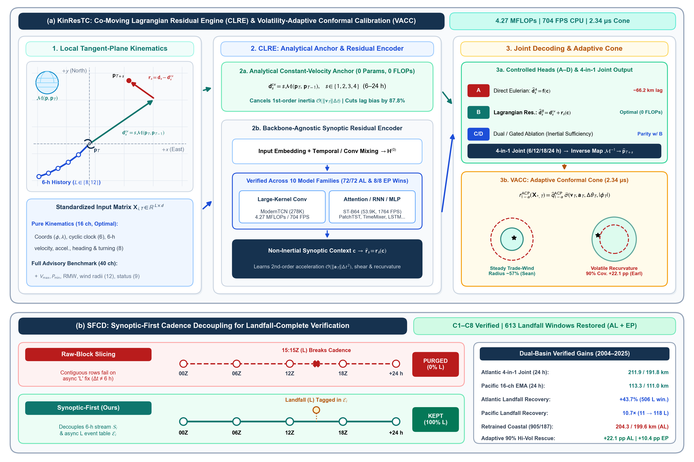
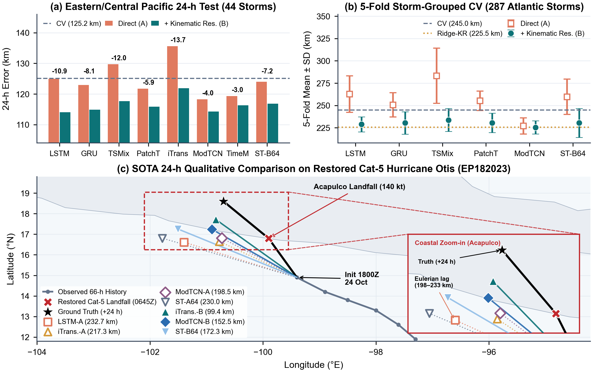

# Beyond Static Coordinates: Physics-Guided Kinematic Residual Learning for Landfall-Complete Tropical Cyclone Track Forecasting
### 超越静态坐标：面向完整近海登陆评估的物理引导运动学残差热带气旋路径预测

[](https://www.python.org/)
[](https://pytorch.org/)
[-0f766e)](https://www.nhc.noaa.gov/data/)
[](LICENSE)
[](https://github.com/WYH302/TyphoFormer-for-Hurricane-Track-Forecasting/releases/tag/kinematic-residuals-2026-09-24)

> **English** | **[简体中文说明](#-项目简介与中文说明)**

An open-source empirical study and reproducibility toolkit for **KinResTC**, a unified three-layer physical-alignment framework uniting **Synoptic-First Cadence Decoupling (`SFCD`)**, a **Co-Moving Lagrangian Residual Engine (`CLRE`, 16-channel 4-in-1 non-iterative multi-horizon joint decoding)**, and **Volatility-Adaptive Conformal Calibration (`VACC`, 2.34 µs dynamic warning cones)** for short-range (6–24 h) tropical cyclone track forecasting across **two official NOAA NHC HURDAT2 ocean basins** (**North Atlantic `AL`** and **Eastern/Central North Pacific `EP`/`CP`**).

本项目整理并开源了统一物理对齐框架 **KinResTC** 在**北大西洋（`AL`）与东/中北太平洋（`EP`/`CP`）双海域**短临（6–24 小时）热带气旋路径预测中的全套复现代码与实测数据，有机整合了**天气尺度优先解耦层（`SFCD`，`C1–C8` 契约）**、**随动拉格朗日残差引擎（`CLRE`，16 通道 4-in-1 非迭代多时效联合解码）**与**零训练成本波动自适应共形校准层（`VACC`，2.34 µs 动态预警锥）**。

<p align="center">
  
</p>

---

## 📖 Key Highlights (English)

1. **Co-Moving Kinematic Residual Parameterization (`kinematic_residual/`):**  
   Anchoring track predictions analytically to local tangent-plane constant-velocity persistence ($B: \widehat{D}_s = D_s^{\mathrm{cv}} + r(c)$) eliminates **87.8%** of along-track lag bias (`−66.17 → −8.06 km`) with **0 extra parameters and 0 extra FLOPs**. Across **ten model families** (Ridge, MLP, LSTM, GRU, TSMixer, PatchTST, iTransformer, **ModernTCN [ICLR 2024]**, **TimeMixer [ICLR 2024]**, and our ST-Transformer), Lagrangian anchoring wins **72/72 (100%)** North Atlantic comparisons, **8/8 (100%)** primary 44-storm Pacific comparisons, and **6/6 (100%)** neural families under leakage-free **five-fold storm-grouped cross-validation (287 storms)**.

2. **Synoptic-First Temporal Reconstruction (`synoptic_reconstruction/` & `kinrestc_synoptic_landfall_gpu.py`):**  
   Conventional contiguous-row HURDAT2 slicing discards **100%** of off-hour future-landfall windows due to interleaved minute-precise landfall (`L`) entries. Our timestamp-indexed protocol (`C1`–`C8` unit-tested contracts) restores **613 future-landfall windows** (**506** Atlantic across 1980–2025 + **107** Pacific across 2004–2025, recovering **Category-5 Hurricane Otis** and **2025 Hurricane Melissa**). End-to-end retrained 16-channel **KinResTC** achieves **204.32 km** (3-seed ensemble **202.96 km**) across all 905 reconstructed 2022–2024 Atlantic windows (**217.61 km** on 101 future landfalls) and **199.59 km** (**198.19 km** ensemble) on 2025, while Lagrangian anchoring cuts Hurricane Otis error by up to **117.9 km**.

3. **Compact 4-in-1 Joint Decoding & Zero-Cost Adaptive Conformal Cones (`tier1_extreme_roi_surgery.py`):**  
   Without adding a single extra training sample, pruning to **16 pure kinematic channels** ($L=8$, EMA `0.985`) inside one shared **4-in-1 Non-Iterative Joint ModernTCN+KR** trunk (**278.2K total params**, **4.27 MFLOPs**, **704 FPS / 1.42 ms** on 1 CPU thread — **4× fewer params** and **6.1× fewer FLOPs** than 4 separate encoders) lowers Atlantic 6/12/18/24-h error to **31.7 / 78.4 / 140.2 / 211.9 km** (2022–2024) and **33.4 / 76.1 / 131.1 / 191.8 km** (2025), while single-horizon ensembles reach **209.61 / 190.57 km** (Atlantic) and **113.25 / 111.01 km** (Pacific), and ultra-compact **53.9K ST-B64** hits **216.09 / 193.21 km** at **0.82 MFLOPs / 1,764 FPS**. Wrapping a **6-scalar (2.34 µs)** **Kinematic Adaptive Conformal Prediction (ACP)** layer rescues top-25% high-volatility recurvature 90% coverage from **72.2% → 94.3% (+22.1 pp)** in the Atlantic (4-in-1 Joint **75.3% → 91.1%**) and **78.7% → 89.1% (+10.4 pp)** in the Pacific while shrinking steady-storm warning radii by up to **−57%**.

<p align="center">
  
</p>

<p align="center">
  
</p>

---

## 📖 项目简介与中文说明

1. **随动拉格朗日运动学残差（零额外参数/FLOPs）**：在局部切平面上以解析等速惯性外推 $D_s^{\mathrm{cv}}$ 为锚点，消除 **87.8%** 沿路径滞后偏差，横扫十类模型家族：北大西洋 **72/72（100%）**、东太平洋 44 风暴主测试集 **8/8（100%）**、无泄漏 5 折风暴分组交叉验证 **6/6（100%）** 全面胜出并显著收敛跨折方差。
2. **天气尺度优先登陆重构（`C1–C8` 契约）**：消除 HURDAT2 档案因非整点登陆（`L`）记录导致的 100% 非整点登陆漏删盲区，双海域累计恢复 **613 个未来登陆窗口**（含 2023 五级飓风 Otis 与 2025 飓风 Melissa）；端到端重训的 16 通道 **KinResTC** 在大西洋 905 窗完整重构集上达 **204.32 km**（3 种子集成 **202.96 km**）、2025 年降至 **199.59 km**（集成 **198.19 km**），101 登陆窗与 2023 五级飓风 Otis 最高降幅达 **117.9 km**。
3. **16 通道 4-in-1 非迭代联合解码与 2.34 µs 动态共形预警锥**：不增加任何额外训练数据，通过 **16 通道纯运动学剪枝 + $L=8$ 回看 + EMA + 4-in-1 非迭代联合解码**（**278.2K 总参数、4.27 MFLOPs、704 FPS**，参数砍 4 倍、计算量砍 6.1 倍），将北大西洋 24 h 误差压至 **211.9 / 191.8 km**（单时效集成 **209.61 / 190.57 km**），东太平洋 2025 刷新至 **111.01 km**；超轻量 **53.9K `ST-B64`** 达 **1,764 FPS（0.82 MFLOPs）**。零训练成本、仅 **6 个标量（2.34 µs）** 的运动学自适应共形预测（ACP）将双海域高波动急转气旋的 90% 覆盖率分别从 **72.2%→94.3%（+22.1 pp）** 与 **78.7%→89.1%（+10.4 pp）**，同时稳态热带风暴预警半径大幅收缩（Sean 实测 `-57%`）。

---

## 📊 Multi-Basin, Ten-Family SOTA & Conformal Highlights / 核心实测汇总

| Model Family / 模型配置 | Params | MFLOPs | CPU FPS (ms) | Atlantic 24 h (22–24 / 25) | Pacific 24 h (22–24 / 25) | 5-Fold Storm CV |
| :--- | :---: | :---: | :---: | :---: | :---: | :---: |
| **Constant-Velocity (`CV`)** | 0 | 0.000 | — | 256.4 / 247.5 | 125.2 / 119.4 | 244.97 ± 18.50 |
| **Ridge Residual (`Ridge-KR`, 16ch)** | 258 | 0.001 | >10k (0.12) | 225.2 / 200.2 | 114.4 / 114.8 | <u>225.54 ± 12.45</u> |
| **LSTM + KR (40ch)** | 227.8K | 5.227 | 1,248 (0.80) | 233.4 / 202.3 | 114.0 / 115.6 | 228.90 ± 8.48 (5/5) |
| **PatchTST + KR (ICLR 2023, 40ch)** | 421.2K | 3.302 | 1,005 (1.00) | 232.7 / 204.7 | 115.9 / 115.8 | 230.56 ± 10.79 (5/5) |
| **TimeMixer + KR (ICLR 2024, 40ch)** | 461.4K | 5.835 | 390 (2.56) | 233.5 / 198.8 | 116.3 / 117.3 | — |
| **ModernTCN + KR (ICLR 2024, 40ch)** | 280.9K | 6.474 | 634 (1.58) | 226.0 / 203.8 | 114.3 / 117.9 | **225.47 ± 7.36** |
| **Ultra-Compact ST-B64 (16ch, L=8, Ours)** | **53.9K** | **0.823** | **1,764 (0.57)** | 216.1 / 193.2 | 116.8 / 114.2 | 230.46 ± 16.12 (5/5) |
| **4-in-1 Joint ModernTCN+KR (16ch, ALL 4 leads)** | **278.2K** | **4.273** | **704 (1.42)** | **211.9 / 191.8** *(6–24h: 31.7/78.4/140.2/211.9)* | — | — |
| **ModernTCN+KR (16ch, L=8, EMA)** | 277.8K | 4.272 | 733 (1.37) | **210.0 / 190.8** *(Hav/Ridge: **209.6 / 190.6**)* | **113.3 / 111.0** | — |

---

## ⚙️ Quickstart & Reproducibility / 快速复现

```bash
# 1. Install dependencies
pip install -r requirements.txt

# 2. Verify C1-C8 data contracts & unit tests
pytest synoptic_reconstruction/test_window_contract.py kinematic_residual/tests/

# 3. Reproduce 10-family SOTA, Pacific cross-basin, 5-fold storm-CV, 4-in-1 Joint, Conformal Cones & SFCD Landfall Closure
python kinematic_residual/sota_sequence_baselines.py
python kinematic_residual/eastern_pacific_cross_basin.py
python kinematic_residual/stage2_sota_cv_profile.py
python kinematic_residual/stage2_cv_and_cases.py
python kinematic_residual/tier1_extreme_roi_surgery.py
python kinematic_residual/kinrestc_synoptic_landfall_gpu.py
python kinematic_residual/export_fig10_and_profile.py
```

---

## 📝 Citation / 引用参考

```bibtex
@article{wu2026kinematic,
  title   = {Beyond Static Coordinates: Physics-Guided Kinematic Residual Learning for Landfall-Complete Tropical Cyclone Track Forecasting},
  author  = {Wu, Yonghao and Wu, Jiayang and He, Sirui and Liu, Chang and Filaretov, Vladimir and Yukhimets, Dmitry},
  year    = {2026},
  url     = {https://github.com/WYH302/TyphoFormer-for-Hurricane-Track-Forecasting}
}
```
