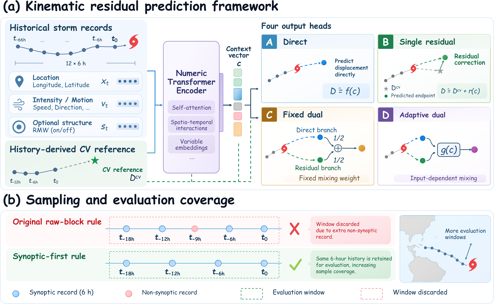
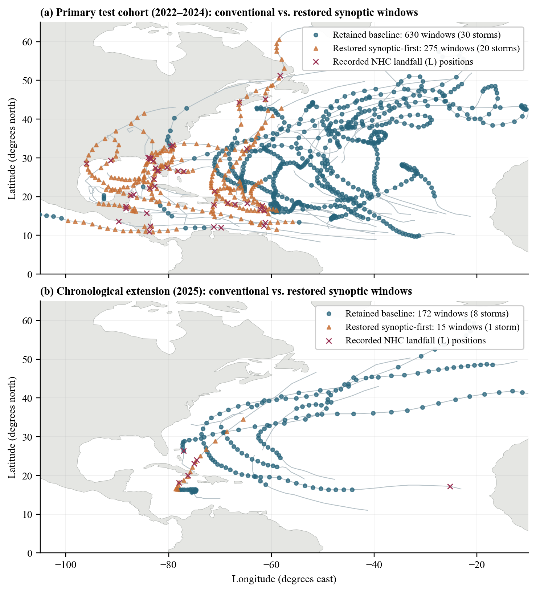
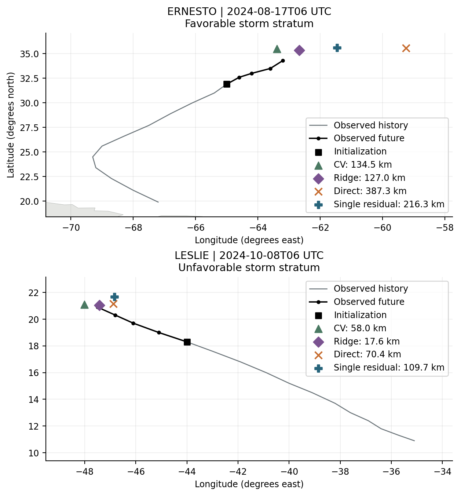

# Kinematic Residual Learning and Evaluation Coverage in Short-Range Atlantic Tropical Cyclone Track Prediction

[](https://www.python.org/)
[](https://pytorch.org/)
[](https://www.nhc.noaa.gov/data/)
[](LICENSE)
[](https://github.com/WYH302/TyphoFormer-for-Hurricane-Track-Forecasting/releases/tag/kinematic-residuals-2026-09-24)
[](https://colab.research.google.com/github/WYH302/TyphoFormer-for-Hurricane-Track-Forecasting/blob/main/demo.ipynb)

Official open-source repository for ***Kinematic Residual Learning and Evaluation Coverage in Short-Range Atlantic Tropical Cyclone Track Prediction*** (by Yonghao Wu, Jiayang Wu, Sirui He, Chang Liu, Vladimir Filaretov, and Dmitry Yukhimets).

<p align="center">
  
</p>

---

## 🌟 Core Scientific Contributions

Short-range (6–24 h) tropical cyclone track forecasting is critical for coastal warnings and emergency evacuations, where storm motion is physically dominated by vortex translational inertia and large-scale steering persistence. This project introduces three foundational advances:

1. **Eulerian-to-Lagrangian Kinematic Frame Alignment (`kinematic_residual/`):**  
   Standard deep sequence models formulate trajectory prediction as unconstrained coordinate regression in a **static Eulerian geographic frame** ($A$), forcing neural weights to re-learn large first-order translational displacements $\mathcal{O}(\|v_T\|\Delta t)$ alongside subtle second-order curvature and acceleration departures $\mathcal{O}(\|a_T\|\Delta t^2)$. We transform the prediction objective into a **co-moving Lagrangian inertial frame** anchored to tangent-plane constant-velocity persistence ($B: \widehat{D}_s = D_s^{\mathrm{cv}} + r(c)$), reducing 6-h and 12-h window-mean errors by **14.6%** (`41.01 -> 35.04 km`) and **13.4%** (`104.86 -> 90.76 km`) while eliminating translational lag during rapid recurvature.

2. **The Inertial Sufficiency Principle & Cross-Family Universality:**  
   Through controlled four-tier output ablations—**Direct ($A$)**, **Single Residual ($B$)**, **Fixed Dual ($C$)**, and **Adaptive Gated Dual ($D$)**—across 108 Transformer fits, 24 MLP fits, and 8 Ridge designs, we establish the ***Inertial Sufficiency Principle***: once the output coordinate frame is physically aligned with vortex translational inertia, a single zero-overhead residual head ($B$) captures the full dynamical advantage without requiring dual-branch gating ($C, D$). This inductive bias universally improves linear Ridge, compact MLP, and deep Transformer architectures at **sub-5 ms single-CPU inference latency**.

3. **Uncovering & Resolving Event-Induced Hazard Censorship (`synoptic_reconstruction/`):**  
   Operational best-track archives (NOAA HURDAT2) interleave routine 6-hourly synoptic observations (`00, 06, 12, 18 UTC`) with asynchronous special records documenting coastal landfall (`L`). We uncover a pervasive benchmark pathology—***Event-Induced Hazard Censorship***—where conventional contiguous-row sequence slicing treats asynchronous `L` records as cadence violations and **purges 100% of future-landfall windows** from the 2022–2024 and 2025 24-h test sets. Our **Synoptic-First Temporal Reconstruction** protocol (governed by 8 formal verification invariants `C1`–`C8`) expands the 2022–2024 test cohort by **43.7%** (`630 -> 905 windows`, `30 -> 40 storms`) and restores **101 landfall-spanning windows across 20 storms**, where Lagrangian kinematic residual learning achieves its largest breakthrough (**$-51.89\text{ km}$ equal-storm error reduction**, 95% bootstrap CI `[13.35, 89.96] km`).

---

## 📊 Key Experimental Highlights

### 1. Controlled Output Parameterization Hierarchy (2022–2024 Primary Test & 2025 Extension)

| Cohort & Feature Set | Horizon | Constant-Velocity (`CV`) | Ridge Residual | MLP Residual | Direct Transformer ($A$) | **Single Residual ($B$)** | Paired Gain ($B - A$, Equal-Storm) |
| :--- | :---: | :---: | :---: | :---: | :---: | :---: | :---: |
| **2022–2024 Test** (With RMW) | **6 h** | 38.66 km | **34.72 km** | 35.10 km | 41.01 km | **35.04 km** | **$-6.19$ km** `[-9.15, -3.38]` |
| **2022–2024 Test** (With RMW) | **12 h** | 95.88 km | 88.62 km | **87.77 km** | 104.86 km | **90.76 km** | **$-13.92$ km** `[-23.08, -4.45]` |
| **2022–2024 Test** (With RMW) | **18 h** | 164.08 km | 154.03 km | **151.63 km** | 172.01 km | **156.90 km** | **$-17.07$ km** `[-33.63, -0.32]` |
| **2022–2024 Test** (With RMW) | **24 h** | 241.00 km | 228.59 km | **226.47 km** | 247.37 km | **235.35 km** | **$-18.39$ km** `[-43.36, +6.68]` |
| **2025 Extension** (No RMW) | **6 h** | 36.12 km | **30.53 km** | 31.11 km | 38.07 km | **31.71 km** | **$-6.10$ km** `[-9.29, -3.40]` |
| **2025 Extension** (No RMW) | **12 h** | 88.24 km | **77.77 km** | 80.52 km | 92.60 km | **84.29 km** | **$-8.96$ km** `[-16.43, -1.78]` |
| **2025 Extension** (No RMW) | **18 h** | 146.97 km | **132.27 km** | 137.45 km | 166.96 km | **144.36 km** | **$-23.22$ km** `[-43.39, -2.59]` |
| **2025 Extension** (No RMW) | **24 h** | 212.56 km | **192.26 km** | 199.78 km | 246.30 km | **213.73 km** | **$-32.87$ km** `[-62.13, -3.28]` |

### 2. Lifting Event-Induced Hazard Censorship: 24-h Performance on Restored Coastal Landfall Trajectories

<p align="center">
  
</p>

| 2022–2024 Reconstructed Cohort (No RMW, Synoptic Features) | Windows ($N$) | Storms ($M$) | Direct Regression ($A$) Equal-Storm Error | **Kinematic Residual ($B$)** Equal-Storm Error | Paired Error Reduction ($B - A$) | 95% Whole-Storm Bootstrap CI |
| :--- | :---: | :---: | :---: | :---: | :---: | :---: |
| **Retained Baseline Windows** (Offshore-Dominated) | 630 | 30 | 262.13 km | **236.28 km** | **$-25.85$ km** | `[-54.44, +0.94]` km |
| **Full Synoptic-First Cohort** | 905 | 40 | 280.18 km | **241.05 km** | **$-39.13$ km** | `[-69.61, -9.97]` km |
| **Newly Restored Windows** | 275 | 24 | 279.64 km | **236.87 km** | **$-42.77$ km** | `[-79.67, -8.56]` km |
| **Future-Landfall Hazard Windows (`L` in $(T, T+24\text{ h}]$)** | **101** | **20** | 284.88 km | **232.98 km** | **$-51.89$ km** | **`[-89.96, -13.35]` km** |

<p align="center">
  
</p>

---

## 🗂️ Repository Structure

```text
├── kinematic_residual/              # Core Lagrangian kinematic residual learning & 4-tier heads (A, B, C, D)
│   ├── prepare_frozen.py            # Tangent-plane projection M(p; p0), Haversine metric & HURDAT2 builder
│   ├── controlled_heads.py          # Direct (A), Single Residual (B), Fixed Dual (C), Adaptive Dual (D)
│   ├── run_controlled.py            # Controlled Transformer training & evaluation runner
│   ├── run_matrix.py                # Full multi-horizon (6, 12, 18, 24 h) & multi-seed experiment matrix
│   ├── ridge_baseline.py            # Linear Ridge kinematic residual predictor
│   ├── mlp_residual_baseline.py     # Compact 2-layer GELU MLP kinematic residual predictor
│   ├── analyze_revision.py          # 10,000-replicate whole-storm cluster bootstrap & paired comparisons
│   ├── benchmark_inference.py       # Single-CPU / GPU inference latency and parameter benchmarks
│   ├── vendor/                      # Spatio-temporal Transformer encoder backbone (STTransformer)
│   └── tests/                       # Unit tests for output heads, baselines, and schedulers
├── synoptic_reconstruction/         # Overcoming Event-Induced Hazard Censorship (Synoptic-First Protocol)
│   ├── prepare_revision.py          # 4-stage Synoptic-First Temporal Reconstruction algorithm
│   ├── test_window_contract.py      # Automated test suite for all 8 formal verification invariants (C1-C8)
│   ├── run_training.py              # End-to-end 24-h synoptic retraining pipeline
│   ├── summarize_revision.py        # Subgroup & coastal landfall hazard statistical evaluation
│   ├── verify_revision.py           # End-to-end provenance & cryptographic hash verification
│   ├── window_selection/            # Raw-feature vs. synoptic-feature transfer evaluation scripts
│   └── results/                     # Verified JSON summaries, contract test outputs & feature schemas
├── figures/                         # Publication-grade vector PDF figures from the manuscript
├── assets/                          # High-resolution PNG/SVG visual previews
├── TyphoFormerPlus/                 # Earlier prototype experiments, multi-modal ablations & audit logs
├── TyphoFormer_original/            # Reference snapshot of upstream LabRAI/TyphoFormer baseline
├── demo.py / demo.ipynb             # Self-contained offline interactive HTML results explorer
├── CITATION.cff                     # GitHub citation metadata
├── AUTHORS.md                       # Confirmed author list and institutional affiliations
└── LICENSE                          # MIT License
```

---

## 🚀 Quickstart

### 1. Environment Setup

```bash
pip install -r requirements.txt
```

### 2. Verify the 8 Synoptic-First Data-Integrity Invariants (`C1`–`C8`)

```bash
pytest synoptic_reconstruction/test_window_contract.py
pytest kinematic_residual/tests/
```

### 3. Reconstruct Synoptic-First HURDAT2 Windows & Run Controlled Experiments

```bash
# Reconstruct hazard-complete synoptic windows and verify landfall annotations
python synoptic_reconstruction/prepare_revision.py

# Train and evaluate controlled output parameterizations (A: Direct, B: Single Residual, C: Fixed Dual, D: Adaptive Dual)
python kinematic_residual/run_matrix.py --data-root data --output results/controlled_matrix --device cuda --evaluate-2025

# Compute 10,000-replicate whole-storm cluster bootstrap confidence intervals
python kinematic_residual/analyze_revision.py --replicates 10000 --include-2025-neural
```

### 4. Interactive Offline Results Viewer

```bash
python demo.py
```

Generates a self-contained HTML dashboard (`demo_output/index.html`) with zero external dependencies.

---

## 📦 Full Reproducibility Archives & Manuscript Release

Large binary artifacts (frozen prediction archives, trained model checkpoints, and complete LaTeX compilation bundles) are hosted in the **[GitHub Release (`kinematic-residuals-2026-09-24`)](https://github.com/WYH302/TyphoFormer-for-Hurricane-Track-Forecasting/releases/tag/kinematic-residuals-2026-09-24)**:

- **`manuscript.pdf`**: Full peer-review manuscript (5-section structure, 58 verified references).
- **`Supplementary_Material.pdf` (`ESM_2.pdf`)**: 43-page supplementary statistical appendix (Appendices A–E).
- **`editable_manuscript.zip`**: Complete compilable LaTeX source bundle, bibliography (`refs.bib`), generated tables, and vector figures.
- **`ESM_1.zip`**: Frozen-score reproduction package (reconstructs every reported table cell and bootstrap interval directly from saved predictions without retraining).

---

## 📝 Citation

If you find our code, kinematic residual formulation, or synoptic-first HURDAT2 reconstruction protocol useful in your research, please cite:

```bibtex
@article{wu2026kinematic,
  title   = {Kinematic Residual Learning and Evaluation Coverage in Short-Range Atlantic Tropical Cyclone Track Prediction},
  author  = {Wu, Yonghao and Wu, Jiayang and He, Sirui and Liu, Chang and Filaretov, Vladimir and Yukhimets, Dmitry},
  year    = {2026},
  url     = {https://github.com/WYH302/TyphoFormer-for-Hurricane-Track-Forecasting}
}
```
